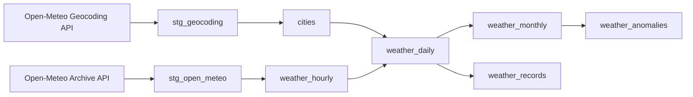

# weather-clickhouse

An ELT pipeline that loads hourly historical weather for 164 Russian cities
(population over 100k) from the Open-Meteo API into ClickHouse and builds
analytical marts on top of it.

Period: from 2016-01-01 to the latest date in the archive (about 5 days ago).
Eight hourly variables: temperature, apparent temperature, humidity,
precipitation, snowfall, wind speed, sea level pressure, weather code.

Built as a learning project to practise ClickHouse and Airflow: MergeTree
engines, partitioning, idempotent loading without transactions, window
functions, orchestration. ClickHouse and Apache Airflow 3 run in Docker on a
Raspberry Pi 5.

## Architecture



| Object | Type | Grain | Description |
|--------|------|-------|-------------|
| `stg_geocoding` | MergeTree, append-only | run × candidate | Raw geocoding results for every run |
| `cities` | ReplacingMergeTree | city | Coordinates, region, population, time zone |
| `stg_open_meteo` | MergeTree, append-only | city × year chunk | Raw API responses, one row per request, values in arrays |
| `weather_hourly` | ReplacingMergeTree | city × hour (UTC) | Unnested hourly data |
| `weather_daily` | ReplacingMergeTree | city × local day | Min / max / avg temperature, precipitation, snowfall, max wind, avg humidity |
| `weather_monthly` | VIEW | city × month | Monthly averages, frost / hot / wet days |
| `weather_anomalies` | VIEW | city × month | Difference from the city norm for the same calendar month |
| `weather_records` | VIEW | city | Coldest and hottest day, max daily precipitation |

## How it works

- **No raw files.** Staging tables are append-only and keep every API
  response, so marts can be rebuilt without calling the API again.
  Each row has `loaded_at` = the run timestamp.
- **Incremental loading.** For each city the watermark is `max(end_date)` in
  `stg_open_meteo`. A run downloads from the next day to the latest archive
  date, in chunks that do not cross a year boundary.
- **API limits.** The free API allows < 10 000 weighted calls per day; one
  year chunk costs ~26 calls. A run loads at most `--max-chunks` (350) chunks
  with a pause between requests. If the limit is hit anyway, the run stops,
  and the data loaded so far is still transformed.
- **Idempotency without transactions.** ClickHouse has no transactions, so a
  failed `INSERT ... SELECT` can leave half of the rows. Transforms take
  `loaded_at >= max(loaded_at)` of the target: the last run is always
  processed again, and ReplacingMergeTree removes the duplicates.
  All reads use `FINAL`.
- **Local days.** Time is stored in UTC. Daily aggregates use the local day of
  each city. ClickHouse needs a constant time zone in `toDate(ts, tz)`, so
  the daily transform runs once per time zone with `{tz:String}` as a query
  parameter. Named zones keep history (e.g. Astrakhan changed UTC+3 → UTC+4
  in 2016).
- **Partitioning by year.** Monthly partitions failed: one transform touched
  ~130 months, more than `max_partitions_per_insert_block` (100).
  Yearly partitions give 11 partitions for the whole history.
- **Geocoding.** The city is chosen by exact name match and the largest
  population. Murmansk has no Russian name in GeoNames, so
  `reference/cities_ru.csv` has an optional `search_name` column for such
  cases.
- **Data quality checks** (`sql/checks`): every check is a query that returns
  rows only when something is wrong. Checks: unresolved cities, gaps in
  hourly data, impossible values, daily hours = hourly rows.

## Run

```bash
cp .env.example .env            # fill in ClickHouse user and password
docker compose up -d            # ClickHouse
python -m venv .venv && .venv/bin/pip install -r requirements.txt

python -m app init              # create tables and views
python -m app cities            # geocode cities
python -m app weather           # load weather, rebuild marts, run checks
python -m app weather --max-chunks 3 --pause 1   # small test run
```

The CLI runs the whole pipeline in one process. It is used for manual runs and
debugging; the scheduled runs are done by Airflow.

## Orchestration (Airflow)

Airflow 3 runs in Docker next to ClickHouse (`airflow/`): LocalExecutor,
PostgreSQL for the metadata database, no Redis or Celery workers — one machine
does not need distributed execution, and it saves memory on the Pi. The image
extends `apache/airflow` with `clickhouse-connect`; the project directory is
mounted into the containers read-only.

| DAG | Schedule | Tasks |
|-----|----------|-------|
| `weather_daily` | every day at 08:00 MSK | `load` → `transform` → `checks` |
| `cities` | manual | `load` → `transform` → `checks` |
| `smoke_test` | manual | checks that project code is importable and ClickHouse is reachable |

- **Thin DAGs.** Tasks only call functions from `app/pipeline.py`
  (`weather_load`, `weather_transform`, `weather_checks`, ...). All logic stays
  in the package, so it also runs without Airflow (`python -m app ...`).
- **Each task is independent.** It opens and closes its own ClickHouse
  connection. Tasks do not pass data to each other: `load` writes to staging,
  and the transforms find new rows by `loaded_at`. Only `cities` passes the run
  timestamp from `load` to `transform` through XCom.
- **Retries are safe** because every step is idempotent: `retries=2`,
  `max_active_runs=1` (no overlapping runs), `execution_timeout` for the
  long API load.
- **API limit is not a failure.** When the daily limit is reached, `load`
  stops and finishes successfully; the loaded chunks are still transformed.

```bash
cd airflow
echo "AIRFLOW_UID=$(id -u)" > .env   # see .env.example
docker compose build
docker compose up airflow-init
docker compose up -d                 # UI on http://<host>:8080
```

## Examples

```sql
-- coldest days
SELECT city, coldest_day, coldest_temp
FROM weather.weather_records
ORDER BY coldest_temp
LIMIT 5;

-- warmest Januaries in Krasnodar compared to the norm
SELECT month, round(temp_anomaly, 1) AS anomaly
FROM weather.weather_anomalies
WHERE city = 'Краснодар' AND toMonth(month) = 1
ORDER BY anomaly DESC;
```

Some results:
- Coldest day in the data: Nefteyugansk, 2016-12-21, −52.6 °C. The same day
  is the record for Nizhnevartovsk (−49.6 °C): an abnormal cold wave in
  Khanty-Mansi Okrug in December 2016.
- January 2025 in Krasnodar was 2.5 °C warmer than the January norm for
  2016–2026.

## ClickHouse vs PostgreSQL

TODO: disk size and query time for the same data.

## Project structure

```
app/
  extract/    geocoding.py, open_meteo.py, http.py (retries, rate limit)
  load/       staging.py
  transform/  core.py
  state.py    watermarks for weather loading
  checks.py   runs sql/checks
  pipeline.py pipeline steps used by the CLI and by the DAGs
dags/         weather_daily.py, cities.py, smoke_test.py
airflow/      docker-compose.yaml, Dockerfile for Airflow
sql/
  ddl/        tables and views
  transform/  staging -> core tables
  checks/     data quality checks
reference/
  cities_ru.csv
```
